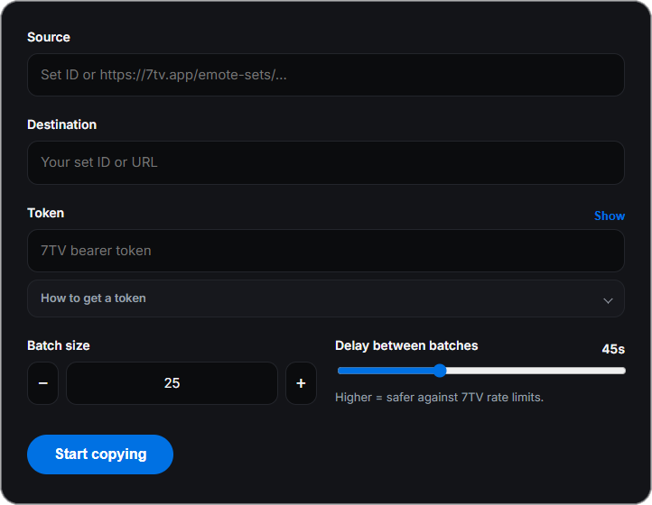

<p align="center">
  
</p>

<h1 align="center">7tv-utils</h1>

<p align="center">
  Copy any <a href="https://7tv.app">7TV</a> emote set.<br>
  Free, open source, and your token never leaves your device.
</p>

<p align="center">
  <a href="https://github.com/Awnicholls/7tv-utils/releases/latest"></a>
  <a href="LICENSE"></a>
  
</p>

---

<p align="center">
  
</p>

Paste a source set, pick your destination, paste your token, and copy. Pacing is automatic.

## Features

- Copy a full emote set from a URL or set ID
- Automatic, adaptive pacing: reads 7TV's rate-limit headers, ramps up when there is headroom, and backs off (waiting out the full reset) when limited
- Skips emotes already in the destination, retries temporary errors, stops cleanly when the set is full
- Cancel anytime
- Token stays on your device, encrypted with the OS keychain

## Download

- **Latest version:** [Releases](https://github.com/Awnicholls/7tv-utils/releases/latest) — `7tv-utils.exe`

Download the `.exe` and run it. There is no installer.

Windows SmartScreen may warn that the publisher is unknown. That is expected: the build is unsigned. Use **More info** → **Run anyway**

## Usage

1. Open **7tv-utils.exe**.
2. **Source** — a set ID or URL like `https://7tv.app/emote-sets/…`
3. **Destination** — the set you own (or can edit). Same ID or URL format.
4. **Token** — your 7TV token (see below, or **How to get a token** in the app).
5. **Start copying**.

### Getting your token

1. Sign in at [7tv.app](https://7tv.app).
2. Open DevTools with `F12` or `Ctrl`+`Shift`+`I`, then the **Application** tab.
3. Under **Local storage** → `https://7tv.app`, copy the value of `7tv-token`. It starts with `ey`.
4. Paste that into the app.

It is stored only on this device and is only sent to 7TV.

## How it works

1. `GET https://7tv.io/v3/emote-sets/{id}` for the source and destination
2. Emotes already in the destination (same ID or name) are skipped
3. Batched `POST https://7tv.io/v3/gql` with `ChangeEmoteInSet(ADD)` mutations (max 30 per batch)
4. Pacing adapts to the `x-ratelimit-<bucket>-remaining/reset` headers: AIMD batch size and gap, full-reset waits on `429`/`RATE_LIMIT_EXCEEDED`, exponential backoff with jitter for network and 5xx errors
5. All network calls run in the Electron main process; the UI talks to it over a sandboxed preload bridge

Core logic: [`electron/seventv/`](electron/seventv). Electron: [`electron/`](electron). UI: [`src/pages/Copier/`](src/pages/Copier).

## Development

Requires Node 22+ and Yarn 4 (`corepack enable`).

```sh
yarn install
yarn dev        # Vite + Electron with reload
yarn lint
yarn dist:win   # release/7tv-utils.exe (portable)
```

`yarn dist` builds for the current OS (dmg on macOS, AppImage on Linux).

## License

[MIT](LICENSE)
